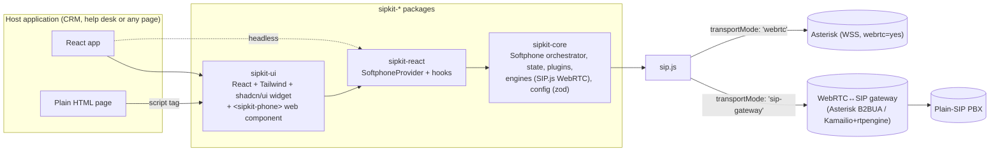
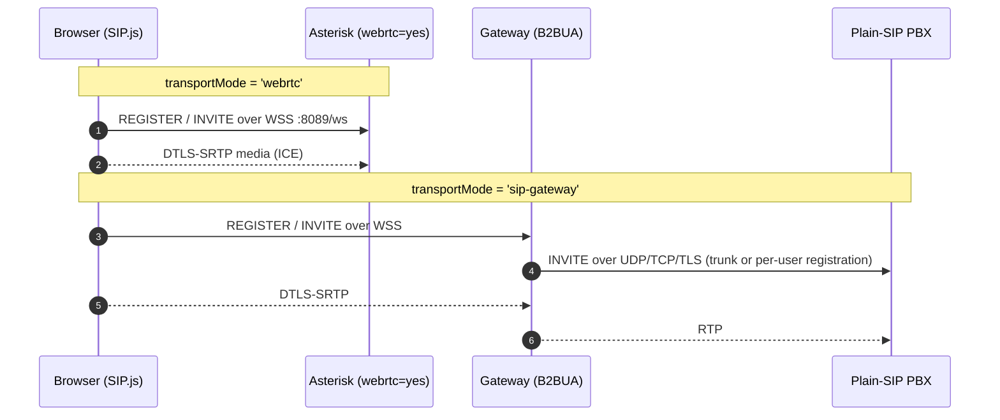
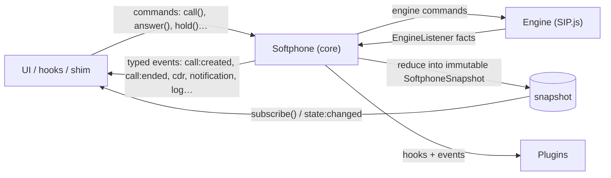

# Architecture

> Status: describes the target design for v1. The packages are being written in parallel, so
> exact export names (for example `Softphone` vs `createSoftphone`) are defined by each
> package's source and README. If this page and the code disagree, the code wins. Please
> fix this page when that happens.

## Packages

| Package | Depends on | Responsibility | Must not |
|---|---|---|---|
| `sipkit-core` | `sip.js`, `zod` | Config validation, `Softphone` orchestrator, call/line state machine, snapshot + events, plugin host, engines, device management, logger | Touch the DOM UI or React. Read globals or DOM inputs |
| `sipkit-react` | core, `react` (peer) | `SoftphoneProvider`, hooks (`useRegistration`, `useCalls`, `useActiveCall`, `useDevices`, `useSoftphoneEvent`, `usePlugin`, …) built on `useSyncExternalStore` | Render UI |
| `sipkit-ui` | core, react, Radix/shadcn, Tailwind | Ready-made widget, extension points (tabs, call actions, panels, slots), `<sipkit-phone>` custom element with Shadow DOM | Contain SIP logic |
| `sipkit-engine-native` | core | `SoftphoneEngine` over a native SIP stack (baresip sidecar, plain SIP over UDP/TCP/TLS) for desktop shells and Node ([native-engine.md](native-engine.md)) | Be loaded in a plain browser page |
| `apps/playground` | all | Dev harness, mock mode for e2e, manual testing against `infra/asterisk` | Ship to production |
| `apps/desktop` | ui, core (bundled) | Electron shell: setup + keychain credentials, tray, hotkeys, notifications, `tel:`/`sip:` links, auto-update ([desktop.md](desktop.md)) | Give the renderer Node access. Put SIP logic in the main process (except a native engine host, V2-DESK-02) |
| `apps/extension` | core, react (mock), ui (bundled) | Chrome/Firefox MV3 extension that hosts the browser's one softphone instance; pages and the popup are `RemoteSoftphone` clients ([browser-extension.md](browser-extension.md), [shared-instance.md](shared-instance.md)) | Send secrets to pages. Accept clients outside the allow-list |

Dependency rule: arrows only point **down** (ui → react → core). Core has no runtime
dependency on React or the browser UI.

## Engines

Core defines the `SoftphoneEngine` interface in `packages/core/src/types.ts`. The `Softphone`
orchestrator **owns all state**. Engines only translate commands into signalling and media, and
report facts back through `EngineListener` (`onRegistration`, `onIncomingCall`,
`onCallProgress`, `onDtmf`, optional `onMessageSummary`, …). So a new engine never has to reimplement line handling,
auto-answer, reject-on-busy, CDRs or the UI.

| Engine | Status | Signalling | Media | When |
|---|---|---|---|---|
| `sipjs-webrtc`, mode `webrtc` | v1 | SIP over **WSS** straight to Asterisk (`res_http_websocket`, PJSIP `webrtc=yes`) | DTLS-SRTP, ICE, opus/G.711 | Asterisk with WebRTC enabled |
| `sipjs-webrtc`, mode `sip-gateway` | v1 | SIP over WSS to a **gateway**, which re-originates plain SIP (UDP/TCP/TLS) to `sipServer` | Gateway converts DTLS-SRTP↔RTP | PBX without WebRTC (plain SIP behind a gateway) |
| `FakeEngine` (`sipkit-core/testing`) | v1 | none (in memory) | none | Unit tests, playground mock mode, Playwright |
| Native/desktop engine | v2 (`sipkit-engine-native`, [native-engine.md](native-engine.md)) | baresip sidecar driven over IPC (ctrl_tcp), plain SIP over UDP/TCP/TLS | Native RTP | Desktop app that must speak plain SIP/UDP without a gateway |

### Transport modes in detail

| Concern | `webrtc` | `sip-gateway` |
|---|---|---|
| Config | `websocketUrls: ['wss://pbx:8089/ws']`, `domain` | `websocketUrls: ['wss://gw:8089/ws']`, `sipServer: 'pbx:5060'`, `sipTransport` |
| Moving parts | Asterisk only (+ TURN if agents are behind strict NAT) | Gateway + PBX (+ TURN) |
| Who authenticates the user | Asterisk | Gateway (and the gateway authenticates to the PBX) |
| Reference setup | `infra/asterisk` default profile | `infra/asterisk` `gateway` profile (Asterisk B2BUA, one browser user per upstream account) |
| Scale-out option | More Asterisk boxes behind DNS SRV / multiple `websocketUrls` | Kamailio (WS↔UDP proxy) + rtpengine is the usual choice for many users. Not provided here |

How `sipServer` reaches the gateway (for example a custom header vs gateway-side config) is
**gateway specific**. The bundled Asterisk gateway ignores it and routes from its own config.
A Kamailio gateway could route on an `X-Upstream` header. This is to be finalised in core
(roadmap V1-CORE-03).

### Adding an engine

Implement `SoftphoneEngine` and pass an `EngineFactory` to the `Softphone`. See
[adding-a-feature.md](adding-a-feature.md#example-2-a-new-engine).

## State and snapshot flow

- **One source of truth.** `SoftphoneSnapshot` (`app`, `registration`, `calls[]`, `activeCallId`, `devices`, `engine`, `voicemail`, `dnd`, `presence`, `chat`) is replaced immutably on every change. React reads it with `useSyncExternalStore`, so components re-render only when their selected slice changes.
- **Events for things that happen once** (`call:ended`, `cdr`, `notification`, `call:dtmf-received`). The snapshot covers things that *are* (current state).
- **Call quality** is sampled by the core (`call:quality` event, `call.quality`, `cdr.quality`) from an optional engine capability `getCallStats()`. See [call-quality.md](call-quality.md).
- **i18n** lives in the UI only. Core emits codes (end reasons, error codes, notification `code` + `params`) with English fallback text; `sipkit-ui` maps them to its message catalogue. See [i18n.md](i18n.md).
- **Commands are async and idempotent where possible.** For example `hangup()` on an already-ended call resolves without error.
- **Voicemail (MWI).** With `voicemail: { enabled: true, number: '*97' }` core calls the optional engine method `subscribeMessageSummary()` each time registration becomes `registered` (so after every reconnect) and `unsubscribeMessageSummary()` when it is lost. NOTIFYs, subscribed or unsolicited, reach `EngineListener.onMessageSummary`; the pure parser `parseMessageSummary()` (RFC 3842) turns bodies into `{ waiting, new, old, urgentNew, urgentOld, account }`, stored as `snapshot.voicemail` and emitted as `voicemail:updated`. `callVoicemail()` dials `voicemail.number`, else the user part of `Message-Account`. Counts reset when the engine stops or voicemail is disabled. Engines without MWI simply omit the methods.
- **Voicemail list (V2-VM-02).** ARI has no voicemail message API, so `services/voicemail-api` (Node, shares the app_voicemail spool) lists, streams, moves (INBOX→Old) and deletes messages and pokes MWI through AMI `VoicemailRefresh`. Core's `VoicemailListController` owns a fetch-based `VoicemailClient` while `voicemail.api.baseUrl` is set, mirrors it into `snapshot.voicemailList` / `voicemail:list` and reloads it whenever the MWI counts change. MWI stays the PBX's truth. See [voicemail.md](voicemail.md).
- **Do Not Disturb.** `setDnd(on)` sets `snapshot.dnd` and emits `dnd:changed`. While on, incoming calls are rejected before plugins run, with `dnd.rejectCode` (default 486), no line is used and nothing rings; a CDR with `reason: 'dnd'` and a "Missed call" notification are emitted. `dnd.enabled` is the initial state; `dnd.persist` stores the toggle in the softphone storage (`sipkit:core:dnd`). With `dnd.mode` 'server' / 'both' the PBX enforces DND: core dials feature codes as invisible service calls (engine ids `svc-*`, consumed by `ServiceCalls` before call control) and reverts on failure. See [server-features.md](server-features.md).
- **Conference modes.** Local mode mixes in the browser (`ConferenceController` + `ConferenceMixer`). `conference.mode: 'server'` moves the parties into an Asterisk ConfBridge room by REFER instead; the room leg carries `call.conference`. UIs read `getConferenceView()` / `useConference()` and render from `capabilities`, never from the mode. See [server-features.md](server-features.md).
- **Presence / BLF.** With `presence: { enabled: true, watch: [...] }` core's `PresenceController` queues one `subscribePresence(target, 'dialog' | 'presence', expires)` per target and package (throttled by `subscribeIntervalMs`) once registered, drops them when registration is lost and resubscribes afterwards. `EngineListener.onPresence` carries parsed reports (`parseDialogInfo()` / `parsePidf()`) or terminations (backoff; 489 never retried). The merged per-target state lands in `snapshot.presence` and `presence:changed`. `pickup(ext)` dials `presence.pickupPrefix + ext`. See [presence.md](presence.md).
- **Chat (SIP MESSAGE).** With `chat: { enabled: true }` the engine's optional `sendMessage()` sends out-of-dialog MESSAGEs (SIP.js `Messager`) and incoming ones reach `EngineListener.onMessage`, whose return value is the SIP status to answer. The engine-agnostic `ChatController` (also used by the React `MockSoftphone`) keys conversations by peer, tracks `sending → sent | failed` from the final response (or a PBX delivery report), counts unread, stores `snapshot.chat` and emits `message:received` / `message:status` / `conversation:read`. History goes through a pluggable `ChatHistoryStorage` (memory by default, localStorage with `chat.persist`). See [chat.md](chat.md).
- **Video (V2-VID-01).** With `video.enabled`, calls carry `hasVideo` / `cameraOn` / `remoteVideo`; engines report facts through the optional `EngineListener.onCallVideo` and expose video-only MediaStreams via `getVideoStreams()`, which `Softphone.getVideoStreams()` returns outside the snapshot (`call:video` signals changes). Conferences are audio-only. See [video.md](video.md).
- **Reload-safe softphone (V2-RESUME-01).** With `resume.enabled` the PBX anchors answered and placed calls in a per-call ConfBridge room; core persists the anchored calls (sessionStorage) and, after a reload, `start()` restores them with the same id and start time (`call.resuming`) and rejoins with `*85<anchor>` (`call:resumed`); a real hangup dials `*86<anchor>`. `resume()` (safe to call instead of `start()`) / `resume(state)` / `exportResumeState()` serve a leader-tab takeover. See [resume.md](resume.md).
- **Calls carry `meta`.** This is a free-form record where plugins attach data (a CRM match, recording id) that the UI can render through slots.

### Host data on incoming calls

A PBX can put its own call id or routing data in INVITE headers. List the header names in `inviteHeaders` (for example `['X-Taskbirt-Call-Id']`) and core copies their values to `Call.inviteHeaders`, keyed by lower-cased name (trimmed, at most 256 characters, at most 20 names). Headers not listed are never exposed. `X-Sipkit-Push-Id` keeps its own field, `Call.pushId`.

## Plugin system

Defined in `packages/core/src/plugin.ts`.

| Capability | API |
|---|---|
| React to events | `ctx.api.on('call:created', …)` |
| Expose an API to the host / UI | return `{ api }` from `setup`; read it with `softphone.plugin(id)` or `usePlugin(id)` |
| Rewrite dialled numbers | `hooks.beforeDial(number)` (runs in registration order) |
| Decide on incoming calls | `hooks.onIncomingCall(call)` returns `ring` / `answer` / `reject` / `forward` (first non-undefined result wins) |
| Persist small data | `ctx.storage` (namespaced key/value) |
| Clean up | `dispose()` |
| Ordering | `dependsOn: ['other-plugin']` |

UI-side extension points (`sipkit-ui`): `extensions.tabs`, `extensions.callActions`,
`extensions.panels`, and `slots.callInfo / headerActions / idleBanner / loginFooter / footer`.
A feature is usually **one core plugin (logic) plus an optional UI extension (rendering)**.
See [adding-a-feature.md](adding-a-feature.md).

## How the layers stack up

| Embedding | What the host writes | Layers involved |
|---|---|---|
| React component | `const sp = createSoftphone({ config, plugins })` then `<SoftphoneProvider softphone={sp}><Softphone slots={…} /></SoftphoneProvider>` (`Softphone` here is the UI component from `sipkit-ui`) | ui → react → core |
| Headless React | Your own components with `useCalls()`, `useRegistration()`… | react → core |
| Web component | `` + `<sipkit-phone ws-url="…" username="…">` + `element.config = { password, … }`, `element.slots`, `element.extensions`. Emits `sipkit:ready`, `sipkit:registration`, `sipkit:call`, `sipkit:cdr`, `sipkit:notification`, `sipkit:error` | ui (bundles React, Shadow DOM, scoped CSS) → core |
| Plain JS | `import { Softphone } from 'sipkit-core'` | core |

## Security model

| Control | Design |
|---|---|
| **No passwords in the DOM** | Credentials go in via API (`updateConfig`, the element's `config` **property**, `createSoftphone({ config })`). Never read from `<input>` elements. The `<sipkit-phone password="…">` **attribute** exists for quick demos only. Do not use it in production, because attributes are visible in the DOM (roadmap V1-SEC-04 tracks deprecating it). |
| **No secrets in logs** | Logger redacts `password`, `Authorization`/`Proxy-Authorization` headers and digest responses before emitting `log` events. `traceSip` is off by default (roadmap V1-SEC-02) |
| **Short-lived credentials (recommended)** | The host backend issues an **ephemeral SIP credential** (for example an HMAC-based password valid for N minutes, or a per-session PJSIP auth object created through ARI/realtime). The browser never sees the agent's long-term secret. Core accepts a `credentialsProvider` callback that is re-invoked on 401/expiry (roadmap V1-SEC-01; API to be added to core) |
| **Token auth on REGISTER** | `registerHeaders` (for example `['Authorization: Bearer <token>']`) adds headers to every REGISTER for a PBX that takes a token. They count as credentials: changing them re-registers (not allowed during a call, like a new password), and the logger redacts them |
| **TURN credentials** | Use coturn `use-auth-secret` (TURN REST API) so the backend mints time-limited TURN credentials. Never embed a static TURN user in the bundle |
| **WSS only** | `websocketUrls` must be `wss://` in production (validation planned; `ws://` allowed only for `localhost` in dev). Media is always DTLS-SRTP, which WebRTC mandates |
| **No hidden third parties** | No default calls to vendor services. The only default is a public STUN server (`stun.l.google.com:19302`) in `iceServers`. Production config should override it with your own STUN/TURN |
| **CSP** | Recommended host policy: `connect-src 'self' wss://pbx.example.com:8089; media-src 'self' blob:; script-src 'self' <cdn>; style-src 'self' 'unsafe-inline'` (inline styles come from the web component Shadow DOM; drop it if you use the CSS file). No `eval` anywhere in our bundles |
| **Isolation** | The web component uses Shadow DOM, and the npm packages export no globals. Only the web component entry (`sipkit-ui/embed`, `sipkit.iife.js`) defines `window.Sipkit` |
| **Supply chain** | pnpm lockfile, `allowBuilds` allow-list, Dependabot/Renovate, CI on every PR, no binaries in the repo |
| **Asterisk side** | `infra/asterisk/README.md` production checklist: real certificates, firewall, fail2ban, `external_media_address`, strong or ephemeral passwords, restricted dialplan contexts against toll fraud |
