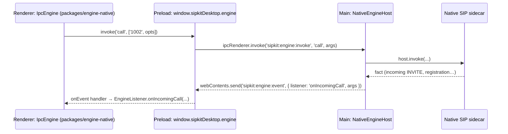

# Desktop app (V2-DESK-01, V2-DESK-03)

`apps/desktop` is an Electron app that wraps the `sipkit-ui` widget. It adds a
first-run setup screen, credentials stored in the OS keychain, a tray icon, single-instance
behaviour, auto-update, global hotkeys, OS notifications and `tel:` / `sip:` / `callto:` links.
For why it uses Electron instead of Tauri, see [ADR 0008](adr/0008-electron-desktop-shell.md).

```
apps/desktop/
  src/main/       Electron main process (window, tray, IPC, hotkeys, notifications, updater)
  src/preload/    contextBridge → window.sipkitDesktop (the only renderer API)
  src/renderer/   React: setup screen, desktop settings, <Softphone> widget
  src/shared/     Pure, unit-tested modules used by main and renderer
                  (dial-url, hotkeys, settings, status, csp, i18n, ipc types)
  e2e/            Playwright _electron specs
  build/          entitlements, afterSign hook, icon.png
  electron-builder.config.cjs, electron.vite.config.ts
```

## Running it

```sh
pnpm install
pnpm -r --filter "./packages/*" build
pnpm --filter sipkit-desktop dev                          # electron-vite with HMR
SIPKIT_DESKTOP_ENGINE=mock pnpm --filter sipkit-desktop dev  # demo without a PBX
pnpm --filter sipkit-desktop build                        # dist/{main,preload,renderer}
pnpm --filter sipkit-desktop test                         # vitest unit tests
pnpm --filter sipkit-desktop test:e2e                     # Playwright _electron (needs build)
pnpm --filter sipkit-desktop package:dir                  # unpacked app in dist/release (no installer)
```

On first launch the setup screen asks for the server (`wss://…`), SIP domain (optional,
defaults to the server host), extension, an optional authorization username and display
name, and the password. After that the widget starts and registers. The gear button in the
widget header (or **Settings…** in the tray) opens **Desktop settings**: account (edit, sign
out), global hotkeys, close-to-tray, notifications, link handling and language. The
widget's own settings tab still handles devices, theme and so on.

To use the dev PBX from `infra/asterisk`, enter `wss://localhost:8089/ws` and extension
`1001` / `sipkitdev123`, then set `"allowInsecureCerts": true` in `settings.json` (see below).
This accepts the self-signed dev certificate, and only for the configured server's host.

## Settings and credentials

| What | Where | Notes |
|---|---|---|
| Settings | `<userData>/settings.json` | Plain JSON, no secrets. Sanitised on read and on every IPC write (`shared/settings.ts`) |
| SIP password | `<userData>/credentials.bin` | Encrypted with Electron `safeStorage`, whose key is in the macOS Keychain / Windows DPAPI / libsecret or kwallet |
| No keychain (e.g. Linux without a keyring) | memory only | The password lasts for this session only. The setup screen says so. It is never written in plain text |

`<userData>` is `~/Library/Application Support/SipKit` on macOS and
`%APPDATA%\SipKit` on Windows.

The SIP.js engine runs in the renderer, so the password goes to the renderer once
(`sipkitDesktop.getPassword()`) to build the softphone config, just as in the browser
softphone. With the native engine (V2-DESK-02) it can stay in the main process.

## Security

- `BrowserWindow`: `contextIsolation: true`, `sandbox: true`, `nodeIntegration: false`,
  `webSecurity: true`, and `backgroundThrottling: false` so calls ring while the window is hidden.
- CSP (`shared/csp.ts`): it is a `<meta>` in the built `index.html` and a response header
  from the main process. `default-src 'none'`, `script-src 'self'` (no inline, no eval),
  `connect-src 'self' wss:` (the PBX is user-configured), `media-src blob: mediastream:`,
  `object-src`/`frame-src 'none'`. `style-src 'unsafe-inline'` is needed for Radix/sonner
  inline styles. In dev, the electron-vite server and HMR socket are also allowed.
- Permissions: only `media`, `notifications`, `fullscreen` and clipboard-write are granted,
  and only to the app's own page (`file://…/renderer/index.html` or the dev server origin).
- Navigation: `will-navigate` and `will-redirect` to anything else are blocked, new windows
  are denied (https links open in the default browser) and `<webview>` is refused.
- IPC: every handler checks that the sender frame is the app page. Payloads are validated
  (`shared/validate.ts`, `sanitizeSettings`, `isTrayStatus`, accelerator parsing, and the
  engine method name regex). Renderer callbacks get plain data, never `IpcRendererEvent`.
- Certificates: self-signed ones are accepted only with `allowInsecureCerts` and only for
  the configured server host.
- Single instance: `app.requestSingleInstanceLock()`. A second launch forwards its argv
  (links) to the first instance and exits.

## Tray

The tray icon is a dark disc with a status dot. The tooltip and first menu line give the
status in words:

| Status | When |
|---|---|
| Offline | not registered (idle, failed, unregistered) |
| Connecting… | connecting / registering |
| Registered | registered, DND off |
| Do not disturb | registered, DND on |
| Incoming call | an incoming call is ringing and no call is established |
| In call | a call is connected, held or being dialled |

The renderer works this out (`deriveTrayStatus()` in `shared/status.ts`) and reports it only
when it changes. The menu has **Show softphone**, a **Do not disturb** checkbox,
**Settings…** and **Quit**. Clicking the icon (Windows/Linux) shows the window. With
**close-to-tray** on (the default), closing the window hides it, and calls keep ringing and
hotkeys keep working. **Quit** (tray, ⌘Q, or app menu) really quits.

## Global hotkeys (V2-DESK-03)

The hotkeys are registered with Electron `globalShortcut`, so they work while another app
has focus.

| Action | Default | Behaviour |
|---|---|---|
| Answer | `CommandOrControl+Shift+A` | Answers the ringing call. Does nothing if nothing rings |
| Hang up / decline | `CommandOrControl+Shift+H` | Hangs up the active call, or declines the ringing call if none is established |
| Mute / unmute | not set | Toggles mute on the connected call |
| Do not disturb | not set | Toggles DND |

You configure them in Desktop settings using Electron accelerator syntax
(`Alt+Shift+F9`, `CmdOrCtrl+K`, …). `shared/hotkeys.ts` normalises and validates them: one
key plus modifiers, a modifier is required unless the key is F13–F24 or a media key, no
duplicates, and `CommandOrControl+X` counts as the same key as `Control+X`. Some shortcuts
fail to register because another application owns them. Those are reported back as "Taken
by another application".

Path of a key press: `globalShortcut` callback → `HotkeyManager` → `CommandBus` (queues
until the renderer is ready) → `sipkit:command` IPC → `executeCommand()` in the renderer →
`softphone.answer()` / `hangup()` / `reject()`. Commands are idempotent.

## Notifications (V2-DESK-03)

- **Incoming call**: shown while the window is not focused (setting
  `notifications.incoming`). It is withdrawn when the call is answered, declined or ends.
  - macOS: an **Answer** action button, and the close button reads **Decline**. Action
    buttons need the "Alerts" notification style and a signed build. With "Banners", a
    click opens the window.
  - Windows: toast XML with **Answer** / **Decline** buttons. They activate
    `sipkit://answer?call=<id>` / `…decline…`, which reach the running instance as
    a second-instance argv.
  - Linux: a plain notification. Clicking it shows the window.
- **Missed call** (setting `notifications.missed`): an incoming call that ended without
  being answered or declined by you. That covers the caller hanging up, the ring timeout,
  or an automatic DND rejection. It is detected from `cdr` events, because DND rejections
  never create a call.

Notifications are silent because the widget plays the ringtone.

## Links: `tel:`, `sip:`, `callto:` (V2-DESK-03)

Packaged builds register the app for `tel`, `callto`, `sip`, `sips` (dialling) and
`sipkit` (notification actions). macOS gets them through `CFBundleURLTypes`. On
Windows the NSIS installer registers them and the app calls
`app.setAsDefaultProtocolClient()` at runtime. Turning off "Open tel:, sip: and callto:
links with this app" removes the app as default handler for the dial schemes. Dev and e2e
builds never register unless `SIPKIT_DESKTOP_REGISTER_PROTOCOLS=1` is set, so the generic
Electron binary does not take over your handler.

How links arrive: macOS `open-url` (also before `ready`), Windows/Linux in argv on first
launch, and `second-instance` argv when the app is already running. `shared/dial-url.ts`
parses them (pure, unit tested):

| Link | Dials |
|---|---|
| `tel:+1-555-123-4567`, `tel:+1 (555) 123.4567;phone-context=…` | `+15551234567` |
| `callto:1002`, `callto://+15551234567` | `1002`, `+15551234567` |
| `sip:1002@pbx.example.com` (host = configured domain or server host) | `1002` |
| `sip:alice@other.example.org` | `sip:alice@other.example.org` |
| `sipkit://dial?number=1002` | `1002` |

Anything else is ignored: unknown schemes, characters outside the allowed sets,
`user:password@` (the password is dropped), or targets longer than 128 characters. A link
that arrives before registration waits up to 30 s for it, then dials.

## Auto-update

electron-updater checks a **generic** HTTPS feed every 4 hours, downloads in the
background and installs on quit. The widget shows "Version x is ready…" when an update has
been downloaded.

- Feed URL: `SIPKIT_UPDATE_URL` at build time (written to `app-update.yml`), or the same
  variable at runtime to override it. Without a feed, auto-update is off.
- Only `https:` is accepted (and `http://localhost` for a local test feed).
- It does nothing when not packaged (dev), with `SIPKIT_DESKTOP_TEST=1`, and with `SIPKIT_UPDATE_DISABLED=1`.
- Publishing: upload `latest.yml` (Windows), `latest-mac.yml` and the `.zip` (macOS updates
  come from the zip), the installers and the `.blockmap` files from `dist/release` to the
  feed directory. macOS only installs updates for signed builds.

## Packaging, signing and notarization

Config: `apps/desktop/electron-builder.config.cjs`. Output: `apps/desktop/dist/release`.

| Target | Artifacts |
|---|---|
| macOS | `dmg` + `zip`, arm64 and x64, hardened runtime, `build/entitlements.mac.plist` (JIT, microphone, camera, network client) |
| Windows | NSIS installer (per-user, choose directory), x64 |
| Linux | AppImage (not in CI) |

Signing and notarization use **environment variables only**. Nothing is committed (see
`apps/desktop/.env.example`):

| Variable | Purpose |
|---|---|
| `CSC_LINK`, `CSC_KEY_PASSWORD` | macOS Developer ID Application certificate (.p12: base64, path or URL) |
| `CSC_NAME` | …or an identity already in the keychain |
| `CSC_IDENTITY_AUTO_DISCOVERY=false` | force an unsigned build |
| `APPLE_API_KEY` (path to .p8), `APPLE_API_KEY_ID`, `APPLE_API_ISSUER` | notarization with an App Store Connect API key (preferred) |
| `APPLE_ID`, `APPLE_APP_SPECIFIC_PASSWORD`, `APPLE_TEAM_ID` | …or with an Apple ID |
| `WIN_CSC_LINK`, `WIN_CSC_KEY_PASSWORD` | Windows Authenticode certificate (.pfx) |
| `WIN_PUBLISHER_NAME` | publisher name (must match the certificate CN) |
| `SIPKIT_UPDATE_URL` | auto-update feed baked into the build |

Notarization (`mac.notarize`) turns on automatically when one set of Apple credentials is
present. The `build/after-sign.cjs` hook logs whether the build was signed and notarized.
For EV certificates on a hardware token or a cloud HSM (Azure Trusted Signing, DigiCert
KeyLocker), use electron-builder's `win.azureSignOptions` or a custom `win.sign` hook. That
is not configured yet because it depends on which certificate you buy.

CI (`.github/workflows/desktop.yml`) runs on `macos-14` and `windows-2022`. It typechecks,
runs the unit tests, builds, runs the Electron e2e with the mock engine, packages
**unsigned** installers (`CSC_IDENTITY_AUTO_DISCOVERY=false`) and uploads them as
artifacts. A manual run with `sign: true` uses these repository secrets: `MAC_CSC_LINK`,
`MAC_CSC_KEY_PASSWORD`, `APPLE_API_KEY_P8` (the key contents), `APPLE_API_KEY_ID`,
`APPLE_API_ISSUER` (or `APPLE_ID` / `APPLE_APP_SPECIFIC_PASSWORD` / `APPLE_TEAM_ID`),
`WIN_CSC_LINK` and `WIN_CSC_KEY_PASSWORD`, plus the repository variable `SIPKIT_UPDATE_URL`.

## Native SIP engine hook (for V2-DESK-02)

The shell is ready for an IPC-backed `SoftphoneEngine` but does not ship one.



- **Bridge shape** (`src/shared/ipc.ts` `EngineBridge`), exposed as `window.sipkitDesktop.engine`:
  - `available(): boolean`: a host is registered. Known after `bootstrap()`.
  - `invoke(method: string, args: unknown[]): Promise<unknown>`: calls
    `SoftphoneEngine[method](...args)` in the host. Method names must match
    `/^[A-Za-z][A-Za-z0-9]{0,63}$/`. Rejects with `NATIVE_ENGINE_UNAVAILABLE` if no host is registered.
  - `onEvent(handler: ({ listener, args }) => void): () => void`: `EngineListener` callbacks
    (`onRegistration`, `onIncomingCall`, `onCallProgress`, …) replayed in order.
  - Arguments and results must survive structured cloning: no functions, no MediaStreams.
    Native media stays native.
- **Main side** (`src/main/engine-host.ts`): `registerNativeEngineHost({ invoke, attach,
  dispose? })`. `attach(emit)` receives the function that sends events to the window. Call
  it from `src/main/index.ts` before the window loads, for example after spawning the
  sidecar.
- **Renderer side** (`src/renderer/create-softphone.ts`):
  `registerNativeEngineFactory((bridge) => createIpcEngineFactory(bridge))`. With
  `settings.engine = 'native'` (or `SIPKIT_DESKTOP_ENGINE=native`) and a registered host,
  `createSoftphone({ engine })` uses it. Otherwise it logs a warning and falls back to SIP.js.

Everything else (tray, hotkeys, notifications, links) works through `SoftphoneApi`, so it
does not depend on the engine.

## Testing

- **Unit (vitest, 105 tests)**: URL parsing, accelerator validation and planning, settings
  sanitising, tray status, CSP, i18n parity, IPC validation, the settings store, the
  credential store (encryption required, memory fallback), `HotkeyManager` with a fake
  `globalShortcut`, `CommandBus`, notification specs per platform, updater config, the
  engine host, PNG encoding, and the renderer `executeCommand` / `attachDesktopIntegration`
  against `MockSoftphone`.
- **e2e (Playwright `_electron`)**: `e2e/desktop.spec.ts` runs the app with
  `SIPKIT_DESKTOP_TEST=1` and the mock engine. It covers first-run setup and storage, the
  sandbox/CSP checks, a `tel:` link in argv plus `second-instance` and `open-url` links that
  dial, the answer/hang-up hotkeys going through IPC, the tray status, incoming/missed
  notifications, Decline, and changing hotkeys in settings. A real global key press cannot
  be synthesised headless, so the test calls the same handler as the `globalShortcut`
  callback (`__sipkitDesktopTest.triggerHotkey`) and asserts that the shortcut is registered
  with the OS.
  - `E2E_DESKTOP_EXECUTABLE=<packaged binary>` runs the same suite against an
    `electron-builder --dir` build.
  - `e2e/sip.spec.ts` (opt-in, `E2E_DESKTOP_SIP_WSS_URL=wss://localhost:18089/ws`) registers
    against a real Asterisk with the SIP.js engine, dials `tel:600` and hangs up through the
    hotkey path.
- `SIPKIT_DESKTOP_TEST=1` is a test switch. It enables an in-memory key store, records
  notifications instead of showing them, and exposes `globalThis.__sipkitDesktopTest` in the
  main process. Setting it needs control of the process environment, which already means
  code execution.

## Strings

The desktop shell's own strings (setup, desktop settings, tray, notifications) live in
`src/shared/i18n.ts` (`en` + `ne`, key parity enforced by the type and a unit test). They
are kept apart from the widget catalogue because the main process uses them without React.
The widget gets the same resolved locale. The Nepali strings need review by a native speaker.

## Known limitations

- The default icon is generated (`pnpm --filter sipkit-desktop icons`). Replace `build/icon.png`
  with the brand icon.
- macOS notification buttons need the "Alerts" style and a signed app. Windows toast
  buttons need the installed (registered) app.
- `globalShortcut` cannot observe key-up or modifier-only shortcuts. Media keys may need
  Accessibility permission on macOS.
- A link or hotkey that arrives while the first-run setup screen is open (no account yet)
  is dropped.
- No launch-at-login option yet. `--hidden` starts the app in the tray, ready for a future
  login item.
- Windows signing with EV / HSM certificates still needs `win.azureSignOptions` or a custom
  sign hook.
