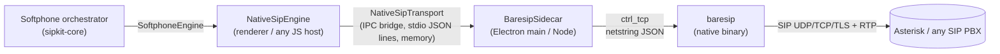

# Native SIP engine (V2-DESK-02)

`sipkit-engine-native` is a `SoftphoneEngine` that speaks **plain SIP over UDP, TCP
or TLS** through a native SIP stack (baresip) running as a sidecar. There is no WebRTC, no
WebSocket and no gateway. It is meant for the desktop app (V2-DESK-01),
but it is host-agnostic: it runs in Node tests today
and in an Electron renderer or main process through an IPC bridge.

Why baresip: [ADR 0009](adr/0009-baresip-native-sip-stack.md).

## Architecture



| Layer | Where | File |
|---|---|---|
| `NativeSipEngine` | Wherever core runs (renderer, Node). Browser-safe, no Node imports | `packages/engine-native/src/engine.ts` |
| IPC protocol | JSON objects: requests, responses, events. Validated on receipt | `src/protocol.ts` |
| Transports | `createMemoryTransportPair()`, `createBridgeTransport(bridge)` (preload/contextBridge), `JsonLinesTransport` / `spawnSidecarTransport()` / `connectTcpTransport()` (Node) | `src/transport.ts`, `src/node/json-lines.ts` |
| `BaresipSidecar` | Node (Electron main, utility process, or the `sipkit-native-sidecar` CLI) | `src/node/baresip-sidecar.ts` |
| baresip control | ctrl_tcp client: netstring framing, command queue, events | `src/node/baresip-control.ts` |
| baresip image | Debian + libre/baresip 4.12 built from source, headless audio | `packages/engine-native/sidecar/` |

One sidecar drives one baresip process with exactly one SIP account (UA index 0).

## Using it

```ts
import { createSoftphone } from 'sipkit-core';
import { nativeSipEngine, createBridgeTransport } from 'sipkit-engine-native';

const softphone = createSoftphone({
  config: {
    transportMode: 'native',            // hasCredentials() needs username + sipServer
    sipServer: 'pbx.example.com:5060',  // registrar / proxy; domain defaults to its host
    sipTransport: 'udp',                // 'udp' | 'tcp' | 'tls'
    username: '2001',
    password: '…',
  },
  // A factory: the orchestrator restarts engines on config changes.
  engine: nativeSipEngine({ transport: () => createBridgeTransport(window.sipkitNativeSip) }),
});
```

Electron wiring (for the desktop shell; not part of this package):

```ts
// main process
import { BaresipSidecar } from 'sipkit-engine-native/node';
import { TransportBase } from 'sipkit-engine-native';
// Implement NativeSipTransport over webContents.send / ipcMain.on('sipkit-native-sip'),
// then: new BaresipSidecar(transport, { host: '127.0.0.1', port: ctrlPort });

// preload
contextBridge.exposeInMainWorld('sipkitNativeSip', {
  send: (m) => ipcRenderer.send('sipkit-native-sip', m),
  onMessage: (cb) => {
    const l = (_e, m) => cb(m);
    ipcRenderer.on('sipkit-native-sip', l);
    return () => ipcRenderer.off('sipkit-native-sip', l);
  },
});
```

Out of process instead: `sipkit-native-sidecar --baresip 127.0.0.1:4444` speaks JSON lines on
stdio (`spawnSidecarTransport(process.execPath, [cli, '--baresip', addr])`), or
`--listen <port>` for TCP.

### Config mapping

| Softphone config | Sidecar account | baresip |
|---|---|---|
| `username`, `domain` (default: host of `sipServer`) | AOR | `<sip:user@domain;transport=…>` |
| `sipServer` / `outboundProxy` | `server` / `outboundProxy` | `outbound="sip:host:port;transport=…"` |
| `sipTransport` | `transport` | AOR + outbound `transport=` |
| `authUsername`, `password` | | `auth_user=`, `auth_pass=` |
| `displayName` | | `"Name" <sip:…>` |
| `registerExpires` | | `uareg <expires> 0` |
| `dtmfMode` (`rfc2833` / `info`) | | `dtmfmode=rtpevent` / `info` |

Values baresip cannot carry in an account line (`;`, `"`, `<`, `>`, whitespace in
user/password/domain) are rejected at `start()` with error code `invalid`.

## Protocol (v1)

```
engine  -> sidecar  { type: 'request',  id, cmd, ...args }
sidecar -> engine   { type: 'response', id, ok: true, result? } | { …, ok: false, error: { code, message } }
sidecar -> engine   { type: 'event', event, ...fields }
```

| Command | Args | Notes |
|---|---|---|
| `hello` | `protocol` | Result `{ protocol, sidecar, capabilities: { attendedTransfer, extraHeaders, tls } }`. Engine refuses another protocol version |
| `start` / `stop` | `account` / – | `start` connects to baresip, replaces any UA (`uadelall` + `uanew`), reports `transport` events |
| `register` / `unregister` | – | Outcome arrives as `registration` events |
| `call` | `callId`, `target` (SIP URI), `headers?` | `callId` comes from the orchestrator |
| `answer`, `hangup` | `callId` | `hangup` of an unknown call is a no-op |
| `reject` | `callId`, `code` | 400-699, default 486 |
| `hold`, `mute` | `callId`, `hold` / `muted` | |
| `dtmf` | `callId`, `tones` | `0-9 A-D * #`, sent one digit at a time (RFC 4733) |
| `transfer` | `callId`, `target` | Blind (REFER). Resolves when the call closes after the REFER; rejects on `CALL_TRANSFER_FAILED` and resumes the call |
| `attendedTransfer` | `callId`, `toCallId` | `unsupported` on baresip (see below) |

Events: `transport`, `registration` (`registering` / `registered` / `unregistered` / `failed` + `code`),
`incoming` (sidecar-assigned `callId`, `remoteNumber`, `remoteDisplayName`, `sipCallId`),
`ringing`, `early-media`, `connected`, `remote-hold`, `ended` (`DisconnectReason` + SIP `code`),
`dtmf`, `log`. Error codes: `unsupported`, `unknown-call`, `not-started`, `invalid`, `timeout`,
`transport`, `failed` (thrown by the engine as `NativeSipError`).

End reasons follow the SIP.js engine: local hangup of a connected call `local-hangup`, local
hangup before answer `cancelled` (outgoing) / `rejected` + code (incoming), remote BYE
`remote-hangup`, caller CANCEL `cancelled`, outgoing failures by status (486/600 `busy`,
603 `rejected`, 408/480 `no-answer`, else `failed`), completed blind transfer `transferred`.
If the sidecar or baresip goes away the engine reports `transport: disconnected`,
`registration: failed` and ends every live call with `failed`.

## What is supported

| Capability | Native engine |
|---|---|
| Register / unregister, auth failure reporting | Yes |
| Outgoing / incoming calls, ringing, early media (183), answer, reject with status, cancel | Yes |
| Hold / unhold, mute (local) | Yes (remote hold is reported when the peer's re-INVITE reaches us) |
| DTMF send / receive (RFC 4733; SIP INFO via `dtmfMode: 'info'`) | Yes |
| Blind transfer (REFER) | Yes |
| Extra INVITE headers (`extraHeaders`) | Yes (`uaaddheader` around the dial) |
| UDP / TCP / TLS | Yes (baresip). Only UDP is exercised by the contract suite: the dev PBX has no TLS transport |
| Attended transfer | **No**. baresip's `atransferstart` places the consult call itself; mapping two existing calls onto it is a follow-up |
| `getMediaStreams()` | **No** (`{}`): media stays native. Local (browser) conference mixing is unavailable; use `conference.mode: 'server'` |
| `forward` (302), `replaceOutgoingTrack`, device selection / output volume, `getCallStats` | **No** (left undefined; the orchestrator feature-detects them) |
| MWI, presence/BLF, SIP MESSAGE chat, video | **No** (left undefined) |

## The baresip sidecar image

`packages/engine-native/sidecar/Dockerfile` builds libre + baresip **v4.12.0** from source with
only `menu`, `ctrl_tcp`, `g711`, `ausine`, `aufile` (static). Audio is headless: `ausine`
(440 Hz) as source, `aufile` writing to `/dev/null` as player. ctrl_tcp listens on 4444,
SIP on 5060, RTP 10100-10199.

```sh
docker build -t sipkit/baresip-sidecar:4.12 packages/engine-native/sidecar
```

baresip behaviour the adapter handles (verified against 4.12 and Asterisk 20):

- `uareg` needs the UA index (`uareg 300 0`); without it nothing happens.
- Un-REGISTER reports `UNREGISTERING` then `REGISTER_OK` for the Expires: 0 request.
- Call commands act on the "current call": the adapter runs `callfind <id>` first, inside one
  exclusive command section. `hangup`, `accept`, `hold`, `resume` take the call id directly.
- `CALL_CLOSED` text does not say who hung up ("Rejected by user" appears for local BYEs), so
  local terminations are tracked by the adapter. Outgoing failures start with the SIP status
  (`486 Busy Here,Q.850;cause=17`).
- The `dial` response carries `call id: <Call-ID>`; `CALL_OUTGOING` can arrive before it, so events
  for unmapped outgoing calls are buffered until the response.
- `/mute` toggles unless given `yes`/`no`; the adapter always passes one.

## Testing

| Suite | Command | What |
|---|---|---|
| Unit (default, fast) | `pnpm --filter sipkit-engine-native test` (part of `pnpm -r test`) | Protocol/transport/netstring tests; `NativeSipEngine` against scripted and fake sidecars **including the full V1-TEST-02 contract over `FakeSidecarNetwork`**; the baresip adapter against a fake ctrl_tcp server; the `Softphone` orchestrator running a call on the native engine |
| Contract vs Asterisk (opt-in) | `pnpm --filter sipkit-engine-native test:contract` | Builds the sidecar image if missing, starts two baresip containers on `sipkit-dev_voip`, runs the shared contract with 2001 / 2002 over UDP |

The contract script's environment: `NATIVE_PBX` (default `172.28.0.10:5060`, the shared dev PBX),
`NATIVE_DOCKER_NETWORK`, `NATIVE_SIDECAR_IMAGE`, `NATIVE_REBUILD=1`,
`NATIVE_SIDECAR_MODE=stdio` (spawns the built CLI per engine and speaks JSON lines over its
stdio instead of running the adapter in-process). ctrl_tcp is published on random loopback ports.

The shared suite itself lives in core (`runEngineContract` in
`packages/core/src/testing/engine-contract.ts`, exported from `sipkit-core/testing`)
and also runs against `FakeEngine` over a loopback network in core's own tests. Harness
capability flags skip what a setup cannot do: `mediaStreams` (browser engines only),
`remoteHoldSignalling` (false behind Asterisk, which answers a hold with music on hold instead
of forwarding the re-INVITE) and `registrationFailure`. Against the dev PBX the DTMF digits are
`1590`: the dialplan dials with `Dial(…,tT)`, so Asterisk swallows `#` and `*` as feature-code
prefixes.

## Bundling baresip in desktop builds (follow-up)

The desktop app ships one baresip binary per OS/arch next to the app and starts it from the
main process with a generated config directory (`config` like `sidecar/config`, but with the
OS audio module, `ctrl_tcp_listen 127.0.0.1:<random free port>`, and an empty `accounts`):

| OS | Build | Audio module | Notes |
|---|---|---|---|
| macOS (arm64, x64) | CMake with `-DSTATIC=ON`, OpenSSL static; universal binary via `lipo` | `coreaudio` | Codesign + notarize the binary with the app; microphone entitlement (`NSMicrophoneUsageDescription`) |
| Windows (x64, arm64) | MSVC / MinGW CMake, `-DSTATIC=ON` | `wasapi` (or `winwave`) | Sign the `.exe`; allow the firewall prompt for UDP 5060 / RTP |
| Linux (x64, arm64) | Same as the Docker image, plus `pulse` / `alsa` / `pipewire` modules | `pulse` | AppImage/deb bundle |

Then: build in CI (cache per `BARESIP_VERSION`), put binaries under `resources/baresip/<os>-<arch>/`,
have the main process spawn it, wait for ctrl_tcp, and serve the renderer through
`BaresipSidecar` over the IPC bridge. Device selection (`setInputDevice` / `setOutputDevice`)
then maps to baresip's `ausrc` / `auplay` commands. Licence: baresip and libre are BSD-3-Clause.
