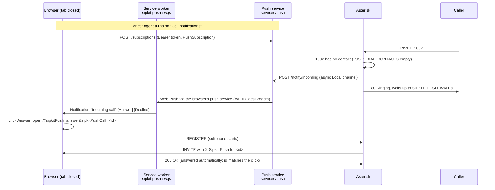

# Push notifications for incoming calls (V2-PUSH-01)

An agent who closed the softphone tab still gets an OS notification when a call comes in.
Clicking **Answer** opens (or focuses) the softphone, which registers and answers that call
while the PBX keeps it ringing.

It is standard **Web Push** (RFC 8030 + RFC 8291 encryption + RFC 8292 VAPID), sent by a
self-hosted service (`services/push`). There is **no Firebase project or vendor account**:
the VAPID key pair is the identity, and each browser's own push service (FCM for Chrome and Edge,
Mozilla autopush, Apple Web Push) delivers the message.



## Pieces

| Piece | Where | What it does |
|---|---|---|
| Push service | `services/push` (Node 22, `web-push`, no framework) | Stores subscriptions per extension, sends the pushes, prunes dead subscriptions, VAPID public key endpoint |
| Dialplan hook | `[sipkit-push]` in `infra/asterisk/config/pbx/extensions.conf` | Fires `POST /notify/incoming` without blocking, keeps the caller ringing until the agent registers, adds `X-Sipkit-Push-Id` |
| Core | `push` config, `snapshot.push`, `subscribePush()` / `unsubscribePush()`, `push:changed` / `push:action` | Permission, subscription, deep link / worker message matching, auto-answer |
| Service worker | `sipkit-ui/sipkit-push-sw.js` | Shows the notification with Answer / Decline, opens or focuses the app |
| UI | `PushSettings` (settings switch), `PushPrompt` (permission prompt + "Connecting the call…" banner), en + ne | |
| React | `usePush()` | State + `subscribe` / `unsubscribe` / `toggle` |

## Softphone config

```ts
createSoftphone({
  config: {
    username: '1002',
    // …
    push: {
      enabled: true,                          // default false
      serviceUrl: 'https://push.example.com', // services/push
      token: crmMintedToken,                  // or getToken: () => fetch('/api/push-token').then(r => r.text())
      // vapidPublicKey: '…',                 // default: GET {serviceUrl}/vapid-public-key
      // serviceWorkerUrl: '/sipkit-push-sw.js', // where your app serves the worker (default)
      // serviceWorkerScope: '',              // default: the worker's directory
      // appUrl: '',                          // page the notification opens (default: current page)
      // autoResubscribe: true,               // re-send the subscription after each registration
      // autoAnswer: true,                    // answer the call the agent clicked "Answer" for
      // launchTimeout: 90,                   // seconds a click waits for its call
    },
  },
});
```

**Serve the service worker from your origin.** Copy (or route) `node_modules/sipkit-ui/dist/sipkit-push-sw.js`
to `/sipkit-push-sw.js`. Its scope must include the softphone page; served from the site root it covers everything.
A worker on a CDN origin cannot be used (browsers require same origin).

`disabledFeatures: ['push']` hides the UI. The bundled `<Softphone>` shows a one-time prompt
under the header and a switch in **Settings → Calls**. The browser permission prompt only appears after
a click (browsers require a user gesture), so call `subscribePush()` from a click handler.

### API

```ts
const state = await softphone.subscribePush();   // asks permission when 'default', then subscribes
await softphone.unsubscribePush();
softphone.getSnapshot().push;   // { enabled, supported, permission, subscribed, busy, error?, pending? }
softphone.on('push:changed', ({ push }) => …);
softphone.on('push:action', ({ launch, callId }) => …); // a notification click; again with callId once matched
softphone.setPushLabels({ title, body: '{caller} is calling', answer, decline }); // the UI does this per language
```

```tsx
const { available, subscribed, permission, busy, error, pending, toggle } = usePush();
```

`error` codes: `permission-denied`, `unsupported`, `service-unreachable`, `service-rejected`,
`no-vapid-key`, `subscribe-failed`, `not-configured` (translated by `pushErrorText`).

### How a click becomes an answered call

1. The worker builds the deep link `appUrl?sipkitPush=answer&sipkitPushCall=<pbx call id>&sipkitPushFrom=<caller>&sipkitPushAt=<ms>`.
   If a tab with that page is open it is focused and gets a `postMessage` instead.
2. The softphone reads it at start (`snapshot.push.pending`), shows "Connecting the call from your notification…"
   and keeps the URL until the call is matched (so React StrictMode or a re-created instance still see it).
3. The next incoming call whose `X-Sipkit-Push-Id` equals the click's call id (fallback: same caller number when the
   PBX sends no header) is answered (`action: 'answer'` and `autoAnswer`) or just shown (`open` = the notification body
   was clicked). The click expires after `launchTimeout` seconds.
4. On registration the softphone closes leftover call notifications; the dialplan's hangup handler sends
   `call-cancelled`, which closes the notification on every device.

**Decline** posts a per-call HMAC signature (from the push payload, no agent token needed) to
`POST /calls/<id>/decline`. The dialplan polls `GET /calls/<id>/status` every 2 s while waiting and answers the caller
busy.

## Push service (`services/push`)

```bash
pnpm --filter sipkit-push-service gen:vapid > services/push/.env   # keys + secrets (edit the rest from .env.example)
pnpm --filter sipkit-push-service start                            # http://localhost:8790
# or
cd infra/asterisk && docker compose --profile push up -d push    # container 172.28.0.30:8790
```

| Endpoint | Auth | Purpose |
|---|---|---|
| `GET /health` | - | liveness |
| `GET /vapid-public-key` | - | `{ publicKey }` for `pushManager.subscribe` |
| `POST /subscriptions` | agent | `{ extension?, subscription, userAgent? }` store (upsert by endpoint, max `PUSH_MAX_PER_EXTENSION`) |
| `GET /subscriptions` | agent | list the extension's subscriptions (endpoint host only) |
| `DELETE /subscriptions` | agent | `{ endpoint? }` one, or all of the extension's |
| `POST /notify/incoming` | PBX | `{ extension, callId, callerId, callerName? }` (JSON or form) push to every subscription |
| `POST /notify/cancel` | PBX | `{ extension, callId, reason? }` close the notification (same Web Push `Topic`, so an undelivered call push is replaced) |
| `GET /calls/:id/status` | PBX | `ringing` / `declined` / `cancelled` / `unknown` (text) |
| `POST /calls/:id/decline` | signed | `{ extension, exp, sig }` from the worker |
| `POST /admin/prune` | PBX | drop subscriptions past `expirationTime` or failing 5 times in a row |
| `GET /debug/events` | PBX, `PUSH_DEBUG=1` | recent notify / send events (tests) |

- **agent** = `Authorization: Bearer <token>`. Production tokens are minted by the CRM backend:
  `skp1.<base64url(JSON {"sub":"1002","iat":…,"exp":…})>.<base64url(HMAC-SHA256(PUSH_TOKEN_SECRET, "skp1.<payload>"))>`.
  `sub` is the extension the bearer may manage. `pnpm --filter sipkit-push-service mint-token -- 1002` mints one;
  `mintToken()` is exported for Node backends. `PUSH_DEV_TOKEN` is a static token for any extension (development only).
- **PBX** = `X-Sipkit-Push-Secret: <PUSH_NOTIFY_SECRET>`.
- Push answers **404 / 410** delete the subscription at once (unsubscribed or expired browser). Other failures count up;
  an hourly prune drops subscriptions failing 5 times in a row and those past `expirationTime`.
- Endpoints must be `https` on a known push service host (`PUSH_ENDPOINT_HOSTS`, default FCM / Mozilla / Apple / Windows),
  never a private address (SSRF guard). `PUSH_ALLOW_INSECURE_ENDPOINTS=1` lifts that for tests only.
- Messages: `TTL` = `PUSH_CALL_TTL` (45 s), `Urgency: high`, `Topic` = hash of the call id.
- Storage: a JSON file (`PUSH_STORE_FILE`, atomic writes) or memory. Implement `SubscriptionStore` for a database when
  you run more than one replica (call status is in memory: run one replica, or sticky-route `/notify` + `/calls`).
- Payload (`services/push/src/payload.ts`): `{ v: 1, type: 'incoming-call', callId, extension, callerId, callerName?, at, ttl, decline? }`
  and `{ v: 1, type: 'call-cancelled', callId, extension }`.

Environment: see `services/push/.env.example`. Rotating the VAPID keys invalidates all subscriptions; agents are
re-subscribed automatically at their next sign-in (`autoResubscribe`) as long as permission stays granted.

## Asterisk

The dev dialplan routes `_1XXX` through `Gosub(sipkit-push,start,1(${EXTEN}))`. It is a no-op unless the container
has `SIPKIT_PUSH_URL` (base URL of the push service as Asterisk reaches it) and `SIPKIT_PUSH_SECRET` (= `PUSH_NOTIFY_SECRET`).
`SIPKIT_PUSH_WAIT` (default 30) is how long the caller rings while the agent comes online.

```bash
SIPKIT_PUSH_URL=http://172.28.0.30:8790 SIPKIT_PUSH_SECRET=<PUSH_NOTIFY_SECRET> docker compose --profile push up -d
```

### Production dialplan snippet

Add the three contexts from the dev `extensions.conf` (`[sipkit-push]`, `[sipkit-push-notify]`, `[sipkit-push-header]`;
`func_curl` / `res_curl` and `app_originate` must be loaded, which they are in stock builds) and call them from the
route that rings agents:

```
exten => _1XXX,1,NoOp(Call to agent ${EXTEN})
 same => n,Gosub(sipkit-push,start,1(${EXTEN}))            ; push + wait when offline
 same => n,GotoIf($["${PUSH_RESULT}" = "declined"]?busy)
 same => n,Dial(PJSIP/${EXTEN},30,tTb(sipkit-push-header^s^1(${UNIQUEID})))
 same => n,Hangup()
 same => n(busy),Busy(5)
```

What `[sipkit-push]` does, so it can be ported to another dialplan (or AGI / ARI):

1. Return at once when push is off or `PJSIP_DIAL_CONTACTS(<ext>)` is not empty (registered agents ring normally).
2. Store caller number / name in astdb (`SIPKITPUSH/<UNIQUEID>/…`) and `Originate(Local/<UNIQUEID>@sipkit-push-notify/n,app,Wait,1,10,a)`:
   the `a` (async) option runs the HTTP request on its own channel, so a slow or dead push service never delays the call.
   `[sipkit-push-notify]` posts the form body `extension=…&callId=<UNIQUEID>&callerId=…&callerName=…` (all `URIENCODE`d;
   caller id is attacker-controlled) with `CURLOPT(httpheader)=X-Sipkit-Push-Secret: …`.
3. Set `CURLOPT` once (headers accumulate per channel), install a hangup handler that posts `/notify/cancel`, send
   `Ringing()` and loop: `Wait(1)` until the extension has a contact (`PUSH_RESULT=registered`), the wait is over
   (`timeout`) or, polled every 2 s, `/calls/<id>/status` says `declined`.
4. The pre-dial handler adds `X-Sipkit-Push-Id: <UNIQUEID>` to the agent's INVITE.

Requirements: WebRTC contacts must disappear when the tab closes (Asterisk removes contacts of a closed WebSocket
transport, as the dev PBX shows); with a long-lived stale contact the route rings the dead contact instead of pushing.
For queues, call the `Gosub` per member (e.g. from a `Local` channel member) or push to all logged-in agents from the
queue entry dialplan.

## Testing

- `services/push`: `pnpm --filter sipkit-push-service test` (store, tokens, auth, validation, fan-out, 404/410 pruning,
  decline / cancel / status, real aes128gcm encryption decrypted by the test against a local fake push endpoint).
- Core / React / UI: `softphone.push.test.ts` (FakePushPlatform), `use-push.test.tsx`, `service-worker.test.ts`.
- Mock e2e `apps/playground/e2e/push.spec.ts` (Chromium new headless): the prompt → permission → subscription stored at
  an in-process push service → `POST /notify/incoming` → encrypted push to a fake endpoint → decrypted → delivered to the
  real service worker over CDP (`ServiceWorker.deliverPushMessage`) → notification with Answer / Decline → Answer focuses
  the tab → the call is answered; deep link with the tab closed; Nepali prompt; unsubscribe from settings.
- Real SIP `apps/playground/e2e/sip/push.spec.ts`: 1002 subscribes and closes its tab; 1001 calls 1002; Asterisk notifies
  the push service container; the push reaches 1002's fake endpoint; the deep link page registers and answers the
  still-ringing call with media; hangup sends `cancel`. Second case: Decline makes the PBX answer busy.

  ```bash
  docker run -d --name sipkit-push --network sipkit-dev_voip --ip 172.28.0.30 \
    --env-file services/push/.env -e PUSH_ALLOW_INSECURE_ENDPOINTS=1 -e PUSH_DEBUG=1 -e PUSH_DEV_TOKEN=dev \
    sipkit/push:dev
  # PBX with -e SIPKIT_PUSH_URL=http://172.28.0.30:8790 -e SIPKIT_PUSH_SECRET=<PUSH_NOTIFY_SECRET>
  E2E_PUSH_URL=http://172.28.0.30:8790 E2E_PUSH_TOKEN=dev E2E_PUSH_SECRET=<PUSH_NOTIFY_SECRET> \
    apps/playground/scripts/e2e-sip-docker.sh -g push
  ```

### Known gaps

- **Headless Chromium has no push service**: `pushManager.subscribe()` fails there, so the tests replace only the
  browser's push transport (a fake `PushManager` whose subscription points at a local fake endpoint with keys the test
  holds). The service's real VAPID signing and encryption, the real service worker and notification are exercised;
  delivery through Google's FCM is not. Check it manually once per release: playground → Settings → "Notify me when this
  tab is closed" in desktop Chrome, close the tab, call the extension.
- Clicking an OS notification cannot be automated; tests call the worker's click handler (`self.sipkitPushWorker`) or open
  the deep link it would open (`clients.openWindow` needs a real click).
- Safari needs the site added to the Dock / Home Screen on iOS for Web Push; desktop Safari 16+ works.
- Chrome may show "This site has been updated in the background" for a `call-cancelled` push that only closes a
  notification (Chrome allows a few silent pushes before doing so).
- Call status (decline) is in memory in the push service: one replica, or sticky routing for `/notify` and `/calls`.
